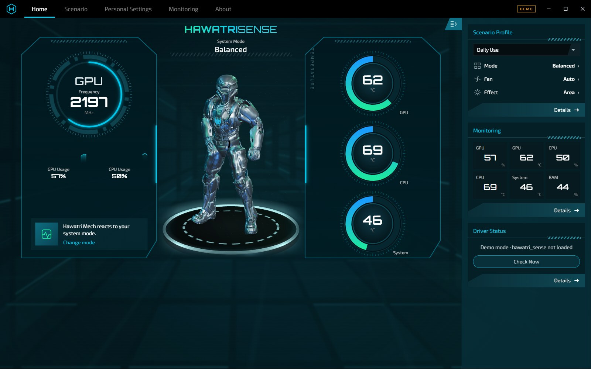
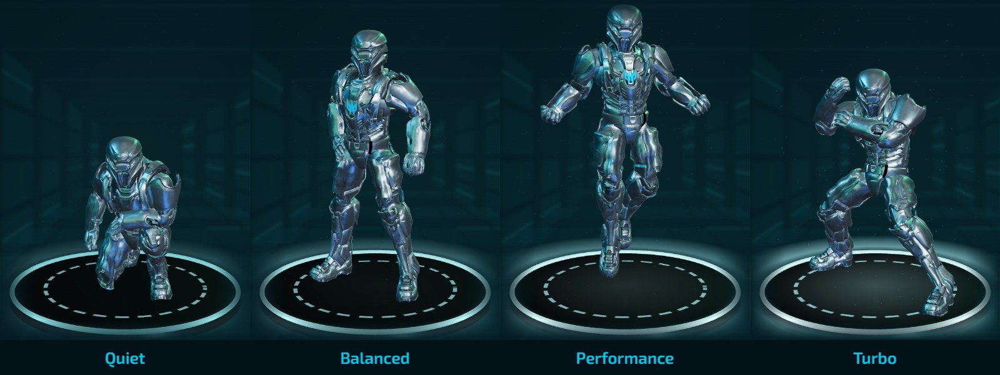
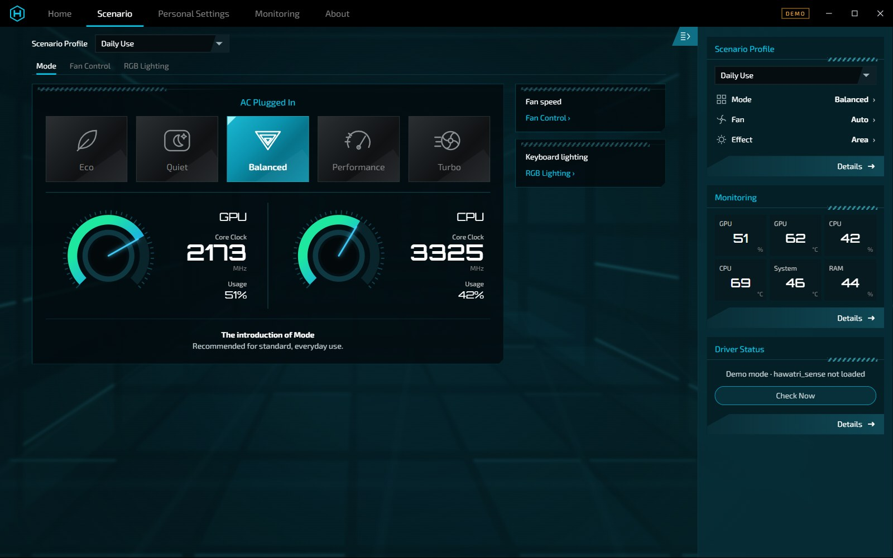
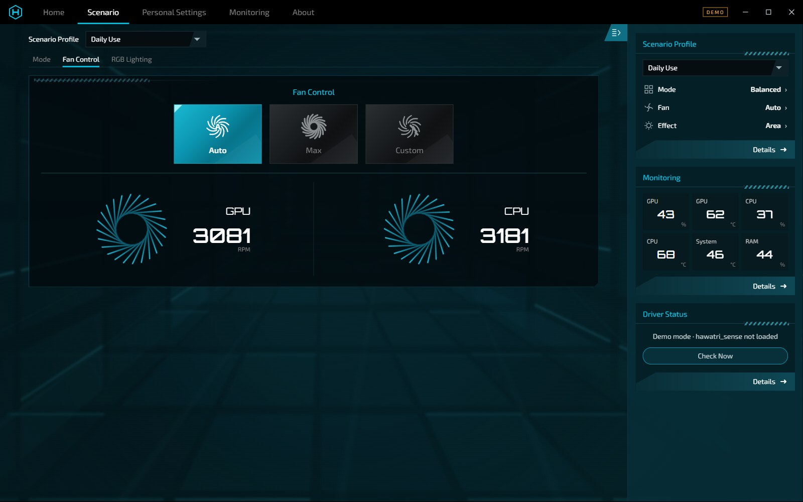
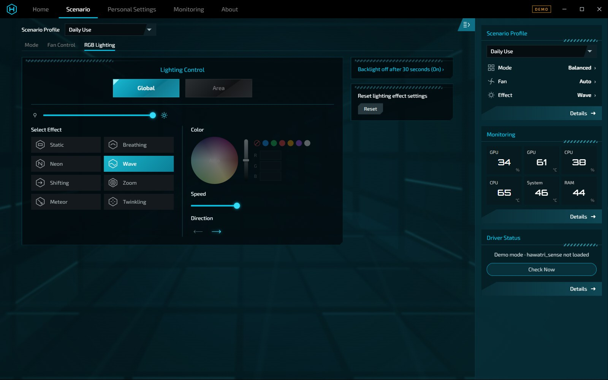
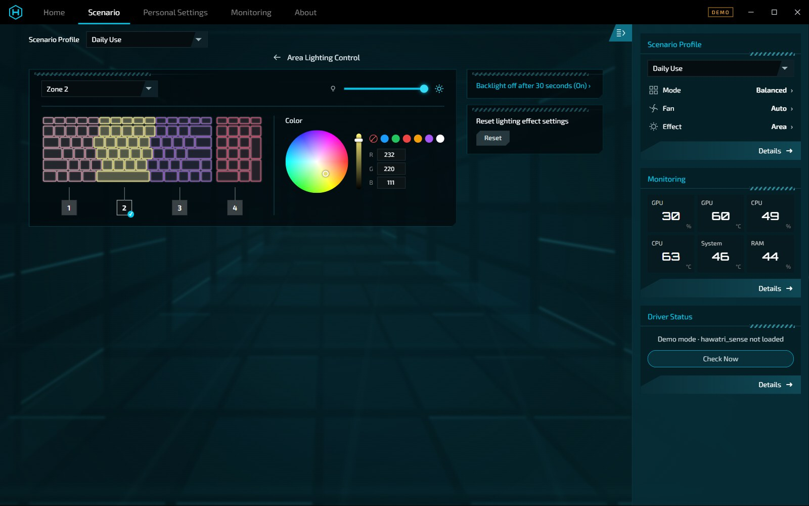
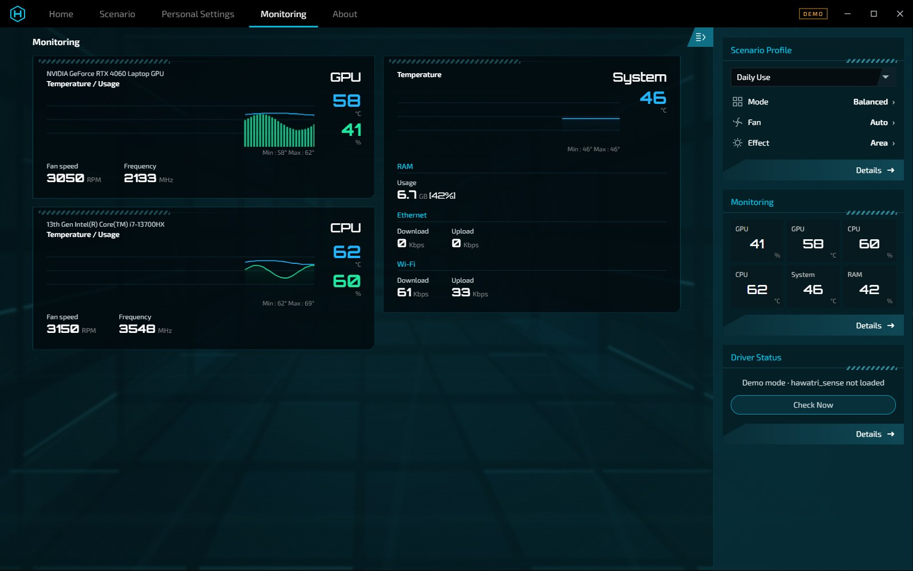
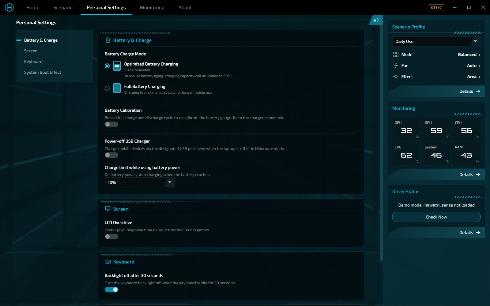

# HawatriSense

**PredatorSense-style control center for Acer Predator & Nitro laptops on Linux — by Hawatri**



HawatriSense is two things in one project: a Linux kernel driver (`hawatri_sense`, replacing `acer_wmi`) and a desktop control center app (HawatriSense Center) that looks and works like PredatorSense on Windows.

- **Same look as PredatorSense** — matching colors, layout, sizes, gauges and fan animation
- **Performance modes** — Eco, Quiet, Balanced, Performance and Turbo
- **Fan control** — Auto, Max or Custom per fan, with live RPM
- **4-zone RGB keyboard** — 8 effects, color wheel, per-zone colors
- **Monitoring** — CPU/GPU temperature, usage, clocks and fan speed, RAM and network
- **Battery & system** — 80% charge limit, calibration, power-off USB charging, LCD overdrive, backlight timeout, boot animation
- **Animated 3D robot** — the PredatorSense robot (from your own install) or the built-in Hawatri mech, reacting to every mode change

## Quick install

One command:

```bash
git clone https://github.com/hawatri/HawatriSense.git && cd HawatriSense && sudo ./install.sh
```

Then log out and back in once, and open **HawatriSense Center** from the app menu (or run `hawatri-sense-center`).

### Supported distros

| Distro | Package manager | Notes |
|--------|-----------------|-------|
| Arch / Manjaro / EndeavourOS | pacman | Uses the distro electron |
| Debian / Ubuntu / Mint / Pop!_OS | apt | |
| Fedora | dnf | |
| openSUSE | zypper | |
| Others | — | Install `gcc`, `make`, kernel headers, and `nodejs` + `npm` manually, then run the script |

### What `install.sh` does

- Installs build tools and the matching kernel headers (including `linux-zen`/`linux-lts` headers on Arch)
- Builds the driver with DKMS, so it automatically rebuilds on kernel updates (with a plain build fallback)
- Blacklists `acer_wmi`
- Installs `hawatri_sense.service`, which loads the driver and applies permissions at boot
- Creates the `hawatri_sense` group and adds you to it
- Installs the app to `/opt/hawatri-sense-center` with a menu entry (downloading Electron 37 via npm when the distro has no electron package)

### Options

- `sudo ./install.sh --no-app` — driver only
- `sudo ./install.sh --uninstall` — removes everything and restores `acer_wmi`

### Arch users

Alternatively, build the Arch package:

```bash
cd packaging && makepkg -si
```

## The robot



The home screen robot reacts to your performance mode. Every mode change plays the mode's intro animation, then its idle loop, with a glow pulse and shockwave on the platform:

| HawatriSense mode | Robot animation |
|-------------------|-----------------|
| Eco | Eco |
| Quiet | Quiet — crouches and rests |
| Balanced | Default — stands ready |
| Performance | Turbo — powers up and hovers |
| Turbo | Extreme — fighting stance |

### Getting the PredatorSense robot

The robot model is **not included** in this repository. HawatriSense loads it from your own PredatorSense install:

- **Windows:** found automatically from the installed PredatorSense app.
- **Linux (dual boot):** mount your Windows partition, then run:

  ```bash
  tools/import-predator-robot.sh
  ```

  It finds `fighter.glb` in the PredatorSense install and copies it to `~/.config/hawatri-sense/fighter.glb`. You can also pass the file path: `tools/import-predator-robot.sh /path/to/fighter.glb`.
- **Any location:** set `HAWATRI_ROBOT=/path/to/fighter.glb`.

The robot is shown with its own light rig (soft blue key light, blue and green rim lights) and a cyan glowing logo, like in PredatorSense.

### Built-in Hawatri mech

Without the robot file — or when started with `--no-robot` — HawatriSense shows its own Hawatri mech instead:

| Mode | Mech behavior |
|------|---------------|
| Quiet / Eco | Kneels and rests, glow dimmed |
| Balanced | Stands, breathing idle |
| Performance | Runs |
| Turbo | Takes off and flies with thruster flames, shockwave rings and camera shake |

## Screenshots

### Scenario → Mode

Eco, Quiet, Balanced, Performance and Turbo, with live GPU/CPU clock and usage gauges.



### Fan Control

Auto, Max or Custom with independent CPU and GPU sliders. The fans spin at a speed that follows the real RPM.



### RGB Lighting – Global

8 effects (Static, Breathing, Neon, Wave, Shifting, Zoom, Meteor, Twinkling), brightness, color wheel, speed and direction.



### RGB Lighting – Area

Per-zone colors on a keyboard map, zones 1–4.



### Monitoring

GPU and CPU temperature/usage graphs with min/max, fan speed and frequency, plus system temperature, RAM, Ethernet and Wi-Fi.



### Personal Settings

80% charge limit, calibration, power-off USB charging, LCD overdrive, keyboard backlight timeout, boot animation & sound.



## Try the UI without the driver

```bash
cd app && npm install && npx electron . --demo
```

Runs with simulated sensors and works on any OS (the screenshots above were taken this way, which is why they show a **DEMO** badge).

| Option | Effect |
|--------|--------|
| `--demo` | Simulated sensors and settings, no driver needed |
| `--no-robot` | Show the built-in Hawatri mech instead of the PredatorSense robot |
| `HAWATRI_ROBOT=/path/to/fighter.glb` | Load the robot from a custom location |

## Manual install (advanced)

For the driver:

```bash
make && sudo make install
```

For the desktop app:

```bash
make install-app
```

## Sysfs interface

After installation, the module creates sysfs entries under:

```
/sys/module/hawatri_sense/drivers/platform:acer-wmi/
```

The module exposes the following attributes:

| Attribute | Description | Values |
|-----------|-------------|--------|
| `fan_speed` | CPU and GPU fan speeds | "CPU,GPU" (0-100%) |
| `battery_limiter` | Charge limiting mode | 0 (disabled), 1 (enabled) |
| `battery_calibration` | Battery calibration mode | 0 (disabled), 1 (enabled) |
| `usb_charging` | USB charging while off, stops at this battery level | 0 (off), 10, 20, 30 (%) |
| `lcd_override` | LCD override mode | 0 (disabled), 1 (enabled) |
| `backlight_timeout` | Backlight timeout | 0 (disabled), 1 (enabled) |
| `boot_animation_sound` | Boot animation sound | 0 (disabled), 1 (enabled) |

For RGB keyboards:
- `four_zoned_kb/four_zone_mode`: Mode,speed,brightness,direction,R,G,B
- `four_zoned_kb/per_zone_mode`: Zone1,Zone2,Zone3,Zone4,brightness (RRGGBB format)

### Manual sysfs usage

#### Fan Control

Control CPU and GPU fan speeds (0-100%):
```bash
# Read current fan speeds
cat /sys/module/hawatri_sense/drivers/platform:acer-wmi/*/fan_speed

# Set CPU fan to 70% and GPU fan to 80%
echo "70,80" | sudo tee /sys/module/hawatri_sense/drivers/platform:acer-wmi/*/fan_speed
```

#### Battery Management

Enable/disable battery charge limiting (80% mode):
```bash
# Check current status
cat /sys/module/hawatri_sense/drivers/platform:acer-wmi/*/battery_limiter

# Enable 80% charge limit
echo 1 | sudo tee /sys/module/hawatri_sense/drivers/platform:acer-wmi/*/battery_limiter

# Disable 80% charge limit
echo 0 | sudo tee /sys/module/hawatri_sense/drivers/platform:acer-wmi/*/battery_limiter
```

#### Keyboard Backlight (Predator models)

For per-zone RGB control:
```bash
# Read current per-zone settings
cat /sys/module/hawatri_sense/drivers/platform:acer-wmi/*/four_zoned_kb/per_zone_mode

# Set different colors for each zone (RRGGBB format)
echo "FF0000,00FF00,0000FF,FFFFFF,50" | sudo tee /sys/module/hawatri_sense/drivers/platform:acer-wmi/*/four_zoned_kb/per_zone_mode
```

#### Thermal Profiles

Switch between thermal profiles:
```bash
# Check available profiles
cat /sys/firmware/acpi/platform_profile_choices

# Set performance mode
echo "performance" | sudo tee /sys/firmware/acpi/platform_profile
```

## Troubleshooting

### Secure Boot

An unsigned module won't load with Secure Boot enabled. On Ubuntu/Fedora, DKMS signs the module with a MOK (Machine Owner Key) — enroll it on the reboot it prompts for. Otherwise, disable Secure Boot.

### "Permission denied" in the app

Make sure you're in the `hawatri_sense` group and have logged out and back in since. The app also falls back to a polkit password prompt if group access isn't available.

### Driver not loading

```bash
sudo dmesg | grep -i hawatri
```

Check that you have kernel headers matching `uname -r` installed.

### `acer_wmi` still loaded

```bash
lsmod | grep acer_wmi
```

This should return no results. If it doesn't, the blacklist hasn't taken effect yet — reboot.

## Supported Models

The driver has specific support for:

- Acer Predator series (PH315-53, PHN16-71, PHN16-72, PH16-71, PH18-71)
- Acer Nitro series (AN16-41, ANV16-41, AN16-43, AN515-58, ANV15-41, ANV15-51, AN515-55)

## Contributing

Contributions are welcome! Please feel free to submit pull requests or open issues at [github.com/hawatri/HawatriSense](https://github.com/hawatri/HawatriSense).

## License

This project is licensed under the GPL-2.0 License - see the [LICENSE](LICENSE) file for details.

## Acknowledgments

HawatriSense stands on the shoulders of the free software community:

- The original `acer-wmi` kernel module authors
- The [Linuwu-Sense](https://github.com/0x7375646F/Linuwu-Sense) project, which pioneered Predator/Nitro RGB and fan control on Linux

GPL compliance requires keeping this credit — thank you to everyone who came before.

### Third-party assets in HawatriSense Center

- [three.js](https://threejs.org) (MIT) renders the 3D robot and mech — `app/renderer/vendor/`
- The corridor background is drawn in code (`app/renderer/backdrop.js`)
- [Orbitron](https://fonts.google.com/specimen/Orbitron) and [Exo 2](https://fonts.google.com/specimen/Exo+2) fonts (SIL Open Font License) — `app/renderer/fonts/`
- The Hawatri mech's reference image was generated with [Meshy](https://www.meshy.ai) (CC BY 4.0); its 3D shape was generated locally with [Hunyuan3D-2mini](https://github.com/Tencent-Hunyuan/Hunyuan3D-2) (Tencent Hunyuan Community License), then textured, rigged and posed in Blender with `tools/rig_mech.py`

### Rebuilding the mech

Blender needs absolute paths:

```bash
blender -b --python "$PWD/tools/rig_mech.py" -- "$PWD/tools/mech-src/hawatri-mech-raw.glb" \
  "$PWD/tools/mech-src/hawatri-mech-raw-nobg.png" "$PWD/app/assets/hawatri-mech.glb"
```

The animations live in the `ANIMS` table in `tools/rig_mech.py` (looping clips `idle`, `run`, `fly`, `kneel`); which clip each mode plays, and its effects, is the `BEHAVIOUR` table in `app/renderer/mech.js`.

---

**HawatriSense** is a product of **Hawatri**, by Kia Hawatri. Not affiliated with or endorsed by Acer. Predator and PredatorSense are trademarks of Acer Inc.
